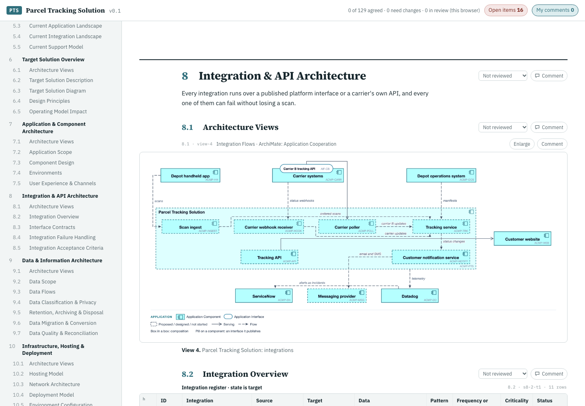
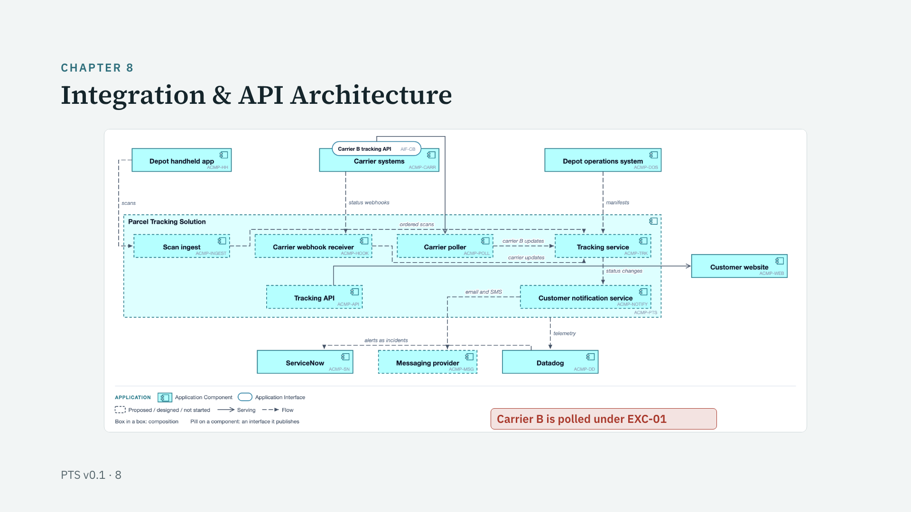
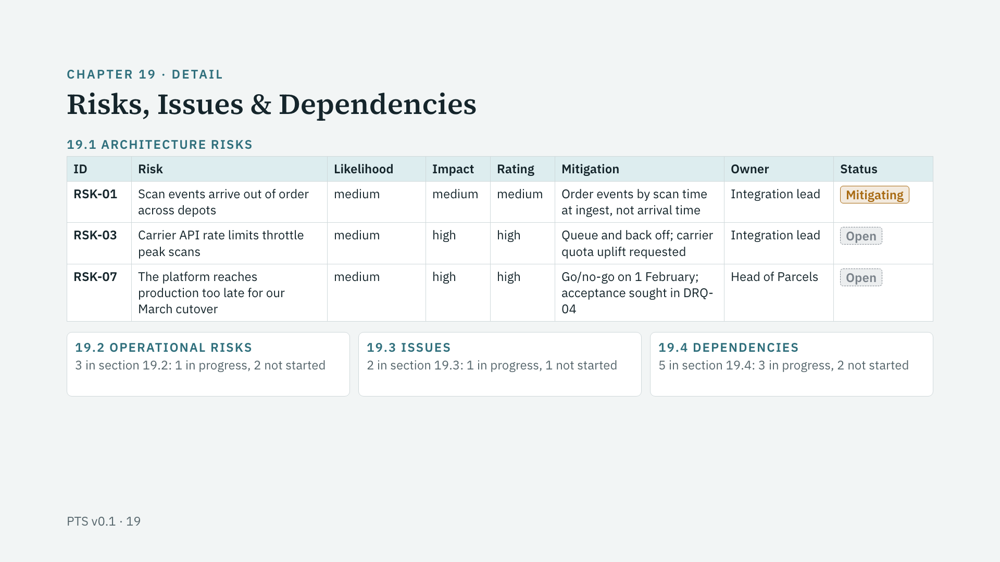

# arch-doc

A Claude Code plugin that writes architecture design documents for review boards: solution architecture documents (SADs), which describe one solution on the platforms it uses, and capability designs, which describe a platform others build on. From one project it builds a Word document, a review site with anchored comments, and a TL;DR slide deck.

Facts live in typed registers (requirements, decisions, risks, integrations, components, owners), the prose cites them, and a checker catches the places where the two drift: a count typed by hand that the register no longer agrees with, a section number that moved, a TBC with no owner, a product name in a logical design. The chapter structure comes from a metamodel, and the organisation's systems and governance forums from a profile that Claude builds by interview, so nothing in arch-doc is tied to one organisation. The organisation's own words carry through: its template's column headers, its names for EA viewpoints, its date format, its id prefixes.



## Install

```
/plugin marketplace add warrendeanlangeveldt/arch-doc
/plugin install arch-doc@arch-doc
```

Then ask in plain words: "write a solution architecture document for the booking service", "draft a capability design for our integration platform", "an HLD for the review board", "turn these notes into a SAD", "extract the metamodel from our SAD template", "read the review comments back into the design". Claude asks a few short batches of questions (the kind of document and what it depends on; your ITSM, EA repository and EA metamodel, cloud, identity, CI/CD and monitoring; your forums; whether you have a template), scaffolds the project, fills the registers, drafts the chapters, draws the figures, runs the checks and builds.

## Requirements

- [uv](https://docs.astral.sh/uv/), which runs the scripts on Python 3.10 or later with `pyyaml`, `python-docx` and `pillow`.
- Optional: Node.js, so `npx` can render Mermaid figures with `@mermaid-js/mermaid-cli@11.12.0` (pinned).
- Optional: Google Chrome or Chromium, to rasterise static SVG figures for Word and to screenshot the site and deck. On macOS the standard install is found; elsewhere `google-chrome` or `chromium` on the PATH, or `CHROME_PATH`.
- Optional: the [arch-diagram](https://github.com/warrendeanlangeveldt/arch-diagram) plugin, for EA views (below).

## Quick start

Claude runs these for you; they also work on their own. From the repository root:

```bash
A=skills/arch-doc/scripts/archdoc.py
uv run --with pyyaml --with python-docx --with pillow python $A init my-design --kind solution --title "Room Booking Service" --owner "Head of Facilities"
uv run --with pyyaml --with python-docx --with pillow python $A -C my-design numbering
uv run --with pyyaml --with python-docx --with pillow python $A -C my-design check
uv run --with pyyaml --with python-docx --with pillow python $A -C my-design build all
```

A fresh scaffold fails `check` until its sections are written; that is the to-do list.

| Command | Does |
|---|---|
| `init <dir> --kind solution\|capability` | scaffolds arch-doc.yaml, a profile, one content file per chapter with its guidance, an empty register per artefact type, `diagrams/` |
| `profile --show\|--validate` | the profile with defaults, or its problems |
| `extract <template.docx> -o metamodel.yaml --profile-out fragment.yaml` | a metamodel and a profile fragment from the organisation's own template |
| `check [--json]` | every check, with file, line and the anchor the place has in the outputs |
| `build docx\|site\|deck\|all [--force]` | the outputs, after the checks |
| `diagrams [--render] [--force] [--json]` | figures per chapter, the tools found, rendering |
| `numbering`, `status` | the numbered structure; per chapter what is filled, open and failing |
| `comments import <file>` | review comments back into `out/comments.json`, by anchor |

## The three outputs

**The Word document.** The organisation's own template filled in place (chapters matched to its headings, guidance replaced, tables cloned, document control filled, the contents rebuilt), or a neutral A4 document with a cover, document control, numbered headings, captions and house-styled tables.

**The review site.** One page with a contents list, every paragraph, list item, table row and figure anchored, an open-items panel listing each record and passage with a TBC, with its owner, and a review status on every section. Published as a claude.ai Artifact, reviewers comment on any paragraph and the status is shared; opened as a local file, comments stay in the browser and export as JSON for `comments import`.

**The TL;DR deck.** Three slides per chapter, in four runs: the chapter's claim and its points, the registers as dense tables with status in words, and a full-slide picture: the chapter's own figure or view, or a picture drawn from its registers (a risk heat map, a cutover flow, a dependency stack, a traceability chain). It plays in a browser or in the Artifact viewer: previous and next buttons, clicks on the slide's outer thirds, the arrow keys or a swipe move through it, and the counter or `G` opens every slide as a thumbnail.





## Examples

`skills/arch-doc/examples/` holds two complete designs for a fictional organisation, Northwind, sharing `northwind-profile.yaml`:

- `northwind-platform`: a logical capability design for an integration platform, version 0.2.
- `northwind-parcels`: a logical-and-physical solution design for parcel tracking that runs on the platform and cites it only through its published interfaces.

Both build all three outputs with no check findings, and each has figures drawn with Mermaid and EA views drawn with arch-diagram from one ArchiMate model.

```bash
uv run --with pyyaml --with python-docx --with pillow python skills/arch-doc/scripts/archdoc.py -C skills/arch-doc/examples/northwind-parcels build all
```

## arch-doc and arch-diagram

arch-diagram draws architecture diagrams: house-style SVG, C4, and EA views in CoreEA, ArchiMate, TOGAF and Essential, from one validated model. arch-doc writes the document those diagrams go in. When arch-diagram is installed, arch-doc draws its EA views as arch-diagram view files over one `model.json` and renders them with it; the same model feeds the catalogue counts that the checks compare with the registers. Without it, Claude suggests installing it once and draws figures in Mermaid instead. The deck's generated pictures need neither.

## How it is organised

- `skills/arch-doc/SKILL.md`: what Claude does, step by step; `references/` holds the detail for each step.
- `skills/arch-doc/metamodels/seed.yaml`: the default metamodel: 22 chapters, 30 artefact types, 15 viewpoints.
- `skills/arch-doc/scripts/`: the CLI and the `archdoc` package.
- `docs/SPEC.md`: the specification.

## Tests

```bash
uv run --with pytest --with pyyaml --with python-docx --with pillow pytest
```

## Licence

MIT. See `LICENSE`.
